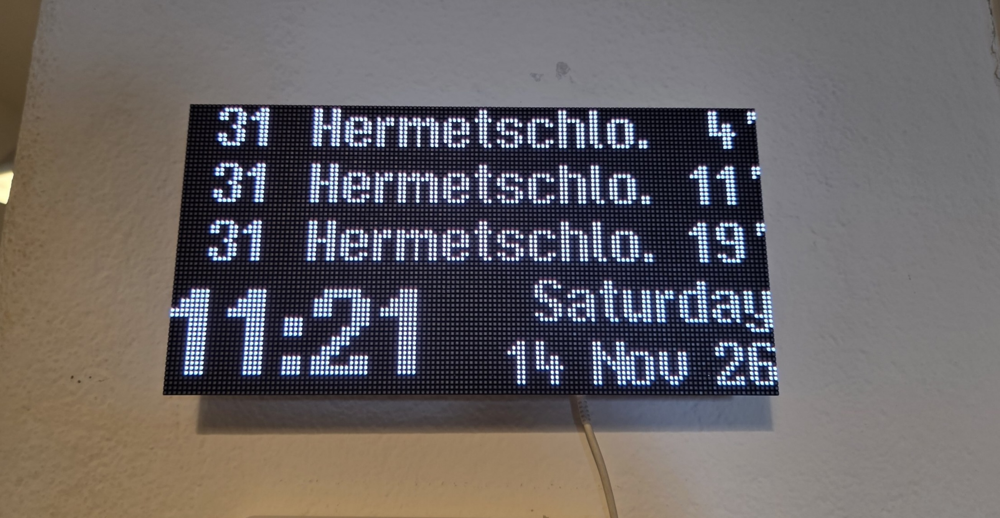

# ZVV Schedule: ESPHome departure board



This is an ESPHome port of [sschueller/vbz-fahrgastinformation](https://github.com/sschueller/vbz-fahrgastinformation). It shows live departures for a Zürich public transport stop on a 128x64 HUB75 RGB matrix. It runs on hallard's [WeMos-Matrix-Shield-DMA](https://github.com/hallard/WeMos-Matrix-Shield-DMA) (V1.9), and a BH1750 light sensor controls the brightness.

It is configured over Home Assistant, but can work without it.

The 3D-printable wall bracket STL model is included, it has a cutout for the BH1750 light sensor.

| Area | Original firmware | This port |
|---|---|---|
| Firmware | Arduino + PlatformIO | ESPHome ≥ 2025.12 (native `hub75` display) |
| Data | TRIAS 2020 API (shut down, returns 404) | [transport.opendata.ch](https://transport.opendata.ch) stationboard (JSON, no API key) |
| Config | Compile-time `Config.h` | Home Assistant / web UI entities, kept across reboots |
| Wi-Fi setup | AutoConnect portal | ESPHome fallback AP + captive portal |
| Brightness | LDR on GPIO36 | BH1750 with a log curve, tunable min/max/curve, manual override, night schedule |
| Time | NTP with a fixed UTC+1 offset | SNTP with `Europe/Zurich` (handles daylight saving) |
| Direction filter | TRIAS H/R direction | Platform filter (e.g. `C` or `C,D`) or Via stop (a stop the trip passes, e.g. `Central`) |
| Low-floor icon | Yes | No (transport.opendata.ch doesn't provide it) |

## Display

Each row shows:

- **Line number box**: tram lines use the VBZ colours.
- **Destination**: "Zürich, " and ", Bahnhof" are stripped, and the text is cropped with "." if too long.
- **Minutes**: the time until departure.
- **Tick**: a thick tick (`` ` ``) means live data and a thin tick (`'`) means timetable only.

The display also follows these rules:

- `>N` means the departure is delayed by 3 or more minutes.
- A tram icon replaces the minutes when the departure is less than a minute away.
- The countdown updates every second from the local clock. Departures are fetched every 30 s.
- A small red marker in the bottom-right corner means the data is more than 5 minutes old.
- With **Show clock** on, the bottom two rows become a clock: the time in large digits on the left, and the weekday over the date (`Friday` / `13 Nov 26`) on the right. The clock stays visible when there are no departures or an error is shown.

## Hardware

| Part | Notes |
|---|---|
| ESP32 MH-ET Live MiniKit (ESP32-WROOM-32) | **Don't use a WROVER/PSRAM variant.** WROVER uses GPIO16/17 for PSRAM, and the shield needs them for CLK and D. |
| WeMos-Matrix-Shield-DMA V1.9 | V1.8/V1.8a boards don't work (see the shield README). |
| 128x64 HUB75 panel, 1/32 scan | The same panel type as the original project. |
| GY-302 BH1750 module | Plugs straight into the shield's 4-pin I2C header J1. |
| 5 V power supply, ≥ 4 A | Power the panel directly. Fit C1 (100 µF) on the shield to avoid brownout loops. |

The 4A power supply is not a hard requirement - with standard display contents that this firmware uses, it consumes only 3-5W on average.
So you can use a standard USB 1-2A adapter and it will work fine.

Probably if you light all the pixels up to 100% brightness - then it will eat 20W, though I haven't tried.

### Pin map (from the shield schematic)

| HUB75 | GPIO | HUB75 | GPIO |
|---|---|---|---|
| R1 | 25 | A | 23 |
| G1 | 26 | B | 19 |
| B1 | 27 | C | 5 |
| R2 | 14 | D | 17 |
| G2 | 12 | E | 18 (via JP1) |
| B2 | 13 | LAT / OE / CLK | 4 / 15 / 16 |

The remaining shield pins:

- I2C: SDA = GPIO21, SCL = GPIO22, with 4K7 pull-ups on the shield. J1 supplies 3.3 V by default (jumper JP3).
- The LDR (GPIO36) and the touch pad (GPIO32) are not used.

### Assembly checklist

1. **E line (JP1):** the middle pad (IO18) must be bridged to the pad for HUB75 pin 8 (E). If the top and bottom halves of the panel show the same content, this jumper is wrong.
2. **BH1750:** the GY-302 pin order is VCC, GND, SCL, SDA, ADDR, which matches J1. ADDR lands on the pad next to J1 (GPIO34, input only) and stays low, so the address is `0x23`. The I2C scan in the boot log confirms it.
3. **LDR:** leave U1/R1 unpopulated. It isn't used.

## Software setup

1. Copy `secrets.yaml.example` to `secrets.yaml` and fill it in. Generate the API key with the command in the file.
2. Flash over USB the first time:
   ```sh
   esphome run zvv-schedule.yaml --device /dev/cu.usbserial-XXXX
   ```
   After that, `esphome run zvv-schedule.yaml` updates it over the air.
3. Add the device in Home Assistant (it's discovered automatically) or open `http://zvv-schedule.local`.
4. Set **Station ID** to the stop's numeric ID. To find it, open `https://transport.opendata.ch/v1/locations?query=Bellevue` and use the `id` field (Zürich, Bellevue = `8576193`).

If Wi-Fi can't connect, the device opens an access point called `zvv-schedule`. The panel shows the password and `192.168.4.1`.

## Entities

| Entity | Purpose |
|---|---|
| Station ID / Platform filter | The stop to show and an optional comma-separated platform list. |
| Via stop | Shows only trips that pass a stop whose name contains one of the comma-separated terms (case-insensitive), e.g. `Schlyfi` or `Central,Bellevue`. The stop you're at doesn't count, and the trip's destination does. Use it at stops without platform data. |
| Directions | Lists every direction at the stop, before filtering, as `[platform] next stop: lines > destinations`, e.g. `Schlyfi: 31 > Hermetschloo; Herdernstrasse \| Waserstrasse: 31 > Kienastenwies`. Check it to see which platform letter or Via stop picks one direction. A platform only appears when the stop has platform data. |
| Auto brightness | On: brightness follows the BH1750 curve. Off: **Manual brightness** is used. |
| Brightness min / max | The brightness range (0–255) of the auto curve. |
| Lux at min / max brightness | The lux values mapped to min and max brightness, on a logarithmic scale. |
| Brightness curve | Gamma of the curve: < 1 brightens faster in dim rooms, > 1 slower. |
| Night schedule + Night start / Night end | Blanks the panel inside the window. The window may wrap past midnight. |
| Show clock | Replaces the bottom two departure rows with the time, weekday and date. |
| Text color | Colour of the destinations, minutes, clock and status text: White, Amber, Yellow, Orange, Green or Cyan. The line-number boxes keep the VBZ colours and errors stay red. |
| Test pattern | Shows R/G/B bars and a "bottom half" marker to check the colour order and the E line. |
| Illuminance, Display brightness | The measured lux (throttled to every 30 s) and the brightness actually applied. |
| Last update, Last error, Heap free, Heap max block | Diagnostics. |

### Tuning brightness

Start with the defaults (min 12, max 255, 1 lx → 500 lx, curve 1.0) and watch **Illuminance** over a day:

- If the panel is too bright at night, lower *Brightness min* or raise *Lux at min brightness*.
- If it never reaches full brightness, lower *Lux at max brightness*.

Each brightness change rewrites the DMA buffers (about 1–2 ms), so changes smaller than 2 steps are skipped.

## Troubleshooting

- **Wrong colours in the test pattern:** use the rotated pin set commented in `substitutions:`. The original firmware needed it for its panel.
- **Panel stays dark or shows garbage:** try `shift_driver: FM6126A`, then `clock_speed: 10MHZ`.
- **Flicker or ghosting:** lower `clock_speed`, or try `min_refresh_rate` 60–120.
- **Low heap or random resets:** check *Heap free* (it should stay above about 40 KB) and *Heap max block*: each fetch allocates a 24 KB response buffer in one piece (`response_buffer_bytes`). A typical response is 7–16 KB. A larger one is reported as "API response too large". Lower `bit_depth` to 6 if needed. `double_buffer` is off on purpose: one panel buffer is 64 KB of DMA RAM, and a second one doesn't fit next to Wi-Fi. Each frame is drawn into a 16 KB off-screen canvas instead and copied to the panel in one pass, so redraws don't blink.
- **Panel still blinks:** every redraw logs `[zvv] redraw` at DEBUG level. If a blink doesn't line up with one of those lines, it isn't the drawing. Check the 5 V supply and C1 (Wi-Fi transmit bursts can make a weak supply sag).
- **Boxes instead of letters:** a character is missing from the font. Add a mapping to `font_safe()` in `includes/departures.h`, or draw the glyph in `tools/gfx2bdf.py` (`EXTRA`) and regenerate the font.

## Files

| Path | Content |
|---|---|
| `zvv-schedule.yaml` | ESPHome configuration |
| `includes/departures.h` | Parsing, layout, VBZ colours, brightness curve (C++) |
| `includes/canvas.h` | Off-screen frame that is copied to the panel in one pass (no blink on redraw) |
| `fonts/vbzfont.bdf` | VBZ font converted to BDF (generated) |
| `fonts/vbzfont-big.bdf` | The VBZ digits scaled 2x for the clock (generated with `--scale 2 --chars "0123456789:"`) |
| `fonts/upstream/vbzfont.h` | Original Adafruit-GFX font from the upstream project |
| `tools/gfx2bdf.py` | Converter. Run `python3 tools/gfx2bdf.py fonts/upstream/vbzfont.h fonts/vbzfont.bdf --preview`, and for the clock font `python3 tools/gfx2bdf.py fonts/upstream/vbzfont.h fonts/vbzfont-big.bdf --scale 2 --chars "0123456789:"` |
| `tools/host_preview.cpp` | Renders the board on your computer as ASCII from live data, with the same font and alignment rules as the device, plus unit checks (see below) |

### Previewing the layout without hardware

`tools/host_preview.cpp` compiles `includes/departures.h` on the host against small stand-ins for ESPHome's display and font classes. It needs the ArduinoJson 7 headers, which `esphome compile` downloads into `.esphome/`:

```sh
AJ=$(dirname "$(find .esphome -path '*src/ArduinoJson.h' | head -1)")
c++ -std=c++17 -I "$AJ" tools/host_preview.cpp -o /tmp/zvv-preview
/tmp/zvv-preview --selftest fonts/vbzfont.bdf fonts/vbzfont-big.bdf   # unit checks + status and clock screens
curl -s "$(/tmp/zvv-preview --url 8576193)" | /tmp/zvv-preview fonts/vbzfont.bdf "C,D"
curl -s "$(/tmp/zvv-preview --url 8576193)" | /tmp/zvv-preview fonts/vbzfont.bdf "" --clock fonts/vbzfont-big.bdf
curl -s "$(/tmp/zvv-preview --url 8576193)" | /tmp/zvv-preview fonts/vbzfont.bdf --color Amber   # non-white text prints as 'o'
```

## Credits and license

The layout, the VBZ colour table and the font come from [vbz-fahrgastinformation](https://github.com/sschueller/vbz-fahrgastinformation) by Stefan Schüller, under the MIT License:

> Copyright (c) 2022 Stefan Schüller
>
> Permission is hereby granted, free of charge, to any person obtaining a copy of this software and associated documentation files (the "Software"), to deal in the Software without restriction, including without limitation the rights to use, copy, modify, merge, publish, distribute, sublicense, and/or sell copies of the Software, and to permit persons to whom the Software is furnished to do so, subject to the following conditions:
>
> The above copyright notice and this permission notice shall be included in all copies or substantial portions of the Software.
>
> THE SOFTWARE IS PROVIDED "AS IS", WITHOUT WARRANTY OF ANY KIND, EXPRESS OR IMPLIED, INCLUDING BUT NOT LIMITED TO THE WARRANTIES OF MERCHANTABILITY, FITNESS FOR A PARTICULAR PURPOSE AND NONINFRINGEMENT. IN NO EVENT SHALL THE AUTHORS OR COPYRIGHT HOLDERS BE LIABLE FOR ANY CLAIM, DAMAGES OR OTHER LIABILITY, WHETHER IN AN ACTION OF CONTRACT, TORT OR OTHERWISE, ARISING FROM, OUT OF OR IN CONNECTION WITH THE SOFTWARE OR THE USE OR OTHER DEALINGS IN THE SOFTWARE.

The shield design is by Charles-Henri Hallard (CC BY-NC-SA 4.0). Departure data comes from [transport.opendata.ch](https://transport.opendata.ch).
